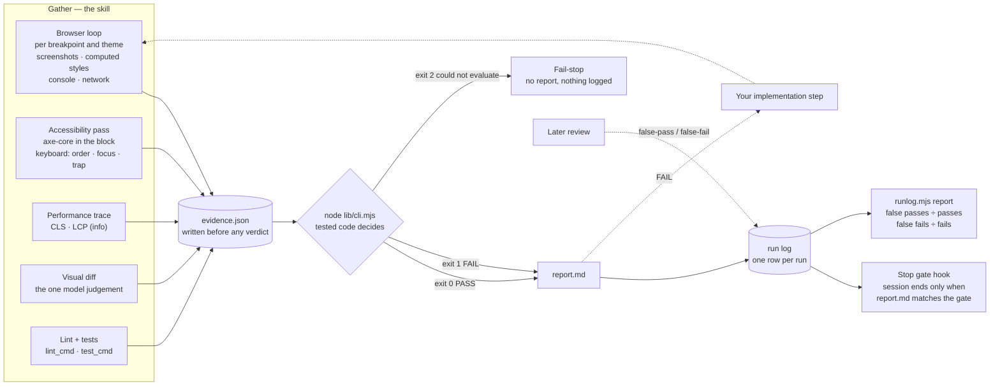

# Workflow: Figma → Spec → Build → Validate

This document describes the end-to-end loop these three skills support and explains how they fit around your own implementation step.

> **Prefer to see it?** The same loop is available as an interactive diagram:
> **[Agentic Workflow presentation](https://skojic.github.io/aem-eds-figma-to-code/agentic-workflow/)**.
> It steps through the files each skill adds to your project, lets you switch the fail-stop gates,
> hooks, MCP calls and subagents on and off, and estimates what the loop costs in context.
> Source in [`agentic-workflow/`](../agentic-workflow/).

---

## Overview

```
/figma-specify <ticket-or-slug>                  ← extract design context from Figma
    → design.md              (the spec, for you)
    → design.matrix.json     (the Layout Matrix, for the gate)

/figma-screenshot <ticket-or-slug> <figma-url>   ← save Figma frames as PNG evidence
    → figma-<slug>-<viewport>.png

[ implement the block from design.md — YOUR step ]

/figma-validate <ticket-or-slug>                 ← gather evidence, then let code decide
    → browser-<viewport>.png · snapshot-<viewport>.json
    → axe-<viewport>.json    (axe-core scoped to the block) · keyboard pass · CLS trace
    → evidence.json          (everything gathered, before anything is decided)
    → node lib/cli.mjs evidence.json → exit 0 PASS · 1 FAIL · 2 could not evaluate
    → report.md              (the verdict and a remediation checklist)
    → node lib/runlog.mjs run …  (one row in the run log, for measuring the gate itself)
```

The skills produce the **spec** (`design.md`) and the **check** (PASS/FAIL report). They do not write block JavaScript or CSS — that is the implementation step between screenshot capture and validation.

**Two artifacts exist for the gate rather than for you.** `design.matrix.json` is the Layout Matrix in structured form, and `evidence.json` is everything `/figma-validate` observed, written before any verdict is reached. Both are there so the decision is made by tested code over a recorded input rather than by a model re-reading prose — see [TESTING.md](TESTING.md).

---

## The board, lane by lane

The [presentation](https://skojic.github.io/aem-eds-figma-to-code/agentic-workflow/) renders the
same three phases as side-by-side lanes. In reading order:

**01 Specify** — invocation → model request payload → pre-flight fail-stops → `mcp.figma` → layout
extraction → **`design.md` + `design.matrix.json` written** → matrix check hook → token-gap pass.

**02 Capture & build** — `/figma-screenshot` → `figma-*.png` saved → **your implementation step**.

**03 Validate** — preflight hook → pre-flight fail-stops → content store → browser breakpoint loop
(and per theme) → visual diff → computed-style comparison → accessibility pass (axe-core + keyboard) →
performance trace → lint and tests → **`evidence.json` written** → evidence check hook →
`node lib/cli.mjs` → report guard hook → PASS / FAIL → run log appended → stop gate hook, with the
FAIL branch looping back into phase 02.

The two emphasised nodes are the ones worth reading the order around. Lane 01 produces both the
spec and its sidecar in one step. Lane 03 separates **gathering** from **deciding**: everything
observed is written down first, and only then does a tested module read that file and reach a
verdict. Lane 03 contains no model-decision node at all — the only judgement left in it is the
visual diff, which is labelled as one.

**Hook nodes** sit in their own *Hooks* layer. The preflight, report guard and stop gate hooks show at
`base`; the two artifact-check nodes (the matrix check in lane 01, the evidence check in lane 03) show
at `extended`. Hooks never decide a verdict — they make sure the gate ran and that nothing contradicts it.

**Two nodes are hidden by default.** The computed-style comparison sits under *Subagents* at
`extended`, and the `node lib/cli.mjs` gate under *Gates* at `base`. If lane 03 looks like it goes
straight from the browser loop to a verdict, turn Subagents up to `extended`. The performance trace
sits under *MCP* at `extended`; the accessibility pass shows at `base`, and so does the lint and
tests gate under *Gates*.

The stop gate is the last node in the lane because the `Stop` hook fires when the session tries to
end — after the report and the run-log row are written.

### Lane 03 in one picture

The same lane, with the two feedback paths drawn in: a FAIL goes back to your implementation step,
and a reviewer who later disagrees with the gate records a correction in the run log.



---

## Prerequisites checklist

Before running any skill, confirm:

- [ ] `figma-to-code.config.md` exists at your project root (fallback: `.claude/figma-to-code.config.md`). See the [config template](../config/figma-to-code.config.template.md) and the [generic EDS example](../config/examples/eds-example.config.md).
- [ ] The Figma MCP (configured as `mcp.figma`) is connected and authenticated.
- [ ] For `/figma-validate`: `node` is on PATH — it runs the verdict core in `skills/figma-validate/lib/`. Nothing to install; those modules are dependency-free ESM.
- [ ] For `/figma-validate`: the browser MCP (configured as `mcp.browser`) is connected.
- [ ] For `/figma-validate`: your local dev server is running (or can be started by the skill).
- [ ] For `/figma-validate` with `runtime_checks.axe` on: the page can load axe-core — either your dev server serves `/node_modules/axe-core/axe.min.js` or the page may fetch the pinned jsDelivr copy. If neither loads, the gate fails the run rather than reporting zero violations.
- [ ] `run_log_path` (default `.figma-validate/runs.jsonl`) is in your project's `.gitignore` — rows carry ticket IDs.
- [ ] If you use a ticket-tracker MCP (`mcp.ticket_tracker`), the ticket has been fetched before calling `/figma-specify`.
- [ ] If you use a content-store MCP (`mcp.content_store`), the MCP is connected before calling `/figma-validate`.

Missing any required MCP or config → the skill fails immediately and tells you what to fix. It will never guess, infer, or fabricate missing data.

---

## Step 1 — `/figma-specify <ticket-or-slug>`

**What it does:**

Reads the Figma file referenced in the ticket (or supplied directly), extracts visual and stylistic design context — layout, spacing, colours, typography, interactive states — and writes a `design.md` spec at the path configured in `spec_output_path`.

`design.md` becomes the source of truth for HTML and CSS during implementation. Functional requirements and acceptance criteria stay in the ticket.

**Key outputs inside `design.md`:**
- HTML Structure — the semantic DOM hierarchy after decoration
- CSS Skeleton — mobile-first, block-scoped, with `@media` ladder
- Layout Matrix — `flex-direction`, `gap`, alignment per container per breakpoint
- Design Token Mapping — each element's CSS properties mapped to design tokens
- Breakpoints and per-breakpoint overrides
- Dynamic Content Elements — with the no-invented-dimension rule applied
- Interactive States
- Token Gaps — any value present in Figma but absent from the design-system token files
- Visual Acceptance Checklist

### The sidecar pattern

A **sidecar** is a secondary file stored next to a primary one, carrying the same information in a
different shape for a different reader. Generated together, kept together, deleted together —
neither is the authoritative one; they have different audiences. The name is the motorcycle image:
attached to the main vehicle, travelling with it, not the vehicle itself.

The familiar example is a source map. `bundle.min.js` ships with `bundle.min.js.map` beside it:
the minified file is what runs, the map is what the browser's developer tools read to show original
line numbers. Nobody reconstructs the original by parsing the minified output — that would be
fragile for no reason, so the build emits both.

Same reasoning here:

| File | Reader | Shape |
|---|---|---|
| `design.md` | a person, during implementation | Markdown — prose, tables, a checklist |
| `design.matrix.json` | `/figma-validate` | JSON — one row per container per breakpoint |

Three options were considered. **Markdown only**, with the gate parsing the table, was rejected:
that table is generated by this skill, so the gate would depend on the shape of its own output, and
a reordered column would silently stop a row being checked. **JSON only**, rendering the table from
it, was rejected because `design.md` exists to be read by a person and reading layout rules out of
JSON is worse. **Both, emitted together** was chosen.

The cost is real: two files carrying the same facts can drift. That is why a disagreement between
them is defined as a defect in this skill rather than a tolerable difference — they come from one
extraction, so there is no legitimate way for them to differ.

*Note that "sidecar" means something else in Kubernetes — a helper container alongside the main one
in the same pod. Same metaphor, different referent.*

### What the sidecar contains

**`design.matrix.json`** goes into the same directory as `design.md`: one row per container per breakpoint, holding only the properties that breakpoint actually sets, with `inherited: true` where the table says *"unchanged from …"*.

```json
{
  "block": "teaser",
  "breakpoints": [{ "name": "mobile", "min": 320 }, { "name": "tablet", "min": 768 }],
  "rows": [
    { "container": ".teaser-inner", "breakpoint": "768",
      "declarations": "flex-direction: row; gap: 32px", "inherited": false },
    { "container": ".teaser-inner", "breakpoint": "1024",
      "declarations": "", "inherited": true }
  ]
}
```

`/figma-validate` reads that file and never the markdown table. The table is generated by this skill, so parsing it back would mean parsing our own output — which breaks the first time a column is reordered or a cell reworded, and breaks silently, as a row that quietly stops being checked while the report still says PASS.

An `inherited` row is not the same as a row repeating the inherited values. It asserts that the breakpoint sets **no override**, so the gate treats a difference there as information rather than a defect — copying the values down would assert an override the CSS does not make, and the gate would then fail a correct implementation.

If the table and the sidecar ever disagree, that is a defect in this skill rather than a tolerable difference: both are produced from the same extraction.

**Invocation:**

```
/figma-specify PROJ-123
/figma-specify my-component
```

The skill resolves the output path from `spec_output_path` in config (e.g. `drafts/specs/PROJ-123/design.md`), and writes `design.matrix.json` beside it. If either file already exists it asks before overwriting.

**Fail-stop conditions:**
- `figma-to-code.config.md` missing → STOP, point to template.
- `mcp.figma` not connected or auth failure → STOP, report the error.
- Ticket tracker MCP unavailable (when `mcp.ticket_tracker` is set) → STOP, report the error.
- Do not fall back to guessing Figma file keys, token values, or ticket descriptions.

---

## Step 2 — `/figma-screenshot <ticket-or-slug> <figma-url>`

**What it does:**

Fetches a single Figma node as a PNG via the `mcp.figma` server and saves it into the same spec directory as `design.md`. Run once per major frame referenced by the spec (e.g. once for each breakpoint frame you want as audit evidence).

These screenshots become the visual reference for `/figma-validate`.

**Invocation:**

```
/figma-screenshot PROJ-123 https://figma.com/design/<fileKey>/My-Component?node-id=1-177
/figma-screenshot my-component https://figma.com/design/<fileKey>/My-Component?node-id=5-42
```

The skill parses `fileKey` and `nodeId` from the URL you supply. It does not use a default file key. The saved file is named `figma-{slug}-{viewport}.png` (or a name you specify).

**Fail-stop conditions:**
- `figma-to-code.config.md` missing → STOP.
- `mcp.figma` unavailable or auth error → STOP.
- Figma URL not provided → ask; never guess a `fileKey` or `nodeId`.

---

## Implementation step (your work)

With `design.md` and the Figma screenshots in place, implement the block:

1. Use the HTML Structure section to build the decorated DOM.
2. Follow the CSS Skeleton — mobile-first, block-scoped, one ladder per component.
3. Resolve every `var(--…)` against your design-system token files (L2/L3 per the `token_layer_model` in your config); fix any Token Gaps flagged in `design.md` before writing block CSS.
4. Check the Layout Matrix: whenever a container's `flex-direction` or `gap` differs between tablet and desktop, restate it explicitly in the `@media (width >= <desktop-breakpoint>)` block — do not rely on cascade inheritance.
5. Do not invent `width` or `max-width` on Dynamic Content Elements unless Figma explicitly defines the property for that node.

The skills have no involvement in this step.

---

## Step 3 — `/figma-validate <ticket-or-slug>`

**What it does:**

Drives the browser MCP to render the authored test content at each configured breakpoint. Compares browser screenshots against the Figma reference PNGs, spot-checks computed styles from `design.matrix.json` via `evaluate_script`, resolves token values, surfaces console errors and failed network requests, runs axe-core and a keyboard pass against the block, records a lab performance trace, and runs lint and tests.

It then writes everything it observed to `evidence.json` and **runs a tested module over that file to reach the verdict**. The skill gathers; code decides.

The comparison itself goes through `lib/compare.mjs`, which normalises before comparing — so `2rem` matches `32px`, `gap: normal` matches `0px`, and a `flex-flow` reading of `row nowrap` matches `row`. Comparing the strings directly produces false failures on every one of those.

**Invocation:**

```
/figma-validate PROJ-123
/figma-validate my-component
```

**Pre-flight (fail-stop if any is missing):**
1. `design.md` exists at the configured `spec_output_path` for this ticket/slug. If not: run `/figma-specify` first.
2. `design.matrix.json` exists in the same directory and parses. If not: re-run `/figma-specify`. The skill will not fall back to reading the markdown table.
3. `node` is on PATH — it runs the verdict core. If not, the skill stops rather than adjudicating the checks by hand.
4. At least one `figma-*.png` screenshot exists in the same directory. If not: run `/figma-screenshot` first.
5. Authored test content is reachable at `preview_url_template` (from config). If `mcp.content_store` is configured, the skill auto-creates the file when it is missing; if the content-store MCP itself is unavailable it stops rather than asking you to create the file by hand. If no `mcp.content_store` is configured, author and serve the content yourself before running.
6. Dev server is running (or can be started).
7. `mcp.browser` MCP is connected.

**Outputs:**
- `{spec_dir}/validation/browser-<viewport>.png` — one screenshot per breakpoint
- `{spec_dir}/validation/snapshot-<viewport>.json` — DOM + a11y tree
- `{spec_dir}/validation/axe-<viewport>[-<theme>].json` — the raw axe-core result, scoped to the block
- `{spec_dir}/validation/evidence.json` — every comparison, token resolution, console and network count, visual-delta severity, gate status and runtime result, written **before** the verdict exists
- `{spec_dir}/validation/report.md` — the verdict, what blocked it, what was recorded without blocking, and a remediation checklist
- one appended row in `run_log_path` — see [The run log](#the-run-log) below

The evidence file is what makes a run reproducible: re-running the verdict over the same evidence cannot produce a different answer, because no gathering happens during adjudication. It is also what you read when a run fails, instead of re-deriving why a model said what it said.

**PASS** requires:
- No blocker visual delta at any viewport
- Every Layout Matrix row matching computed style **at a breakpoint that sets the property** — a row marked `inherited` declares no override, so a difference there is recorded as information, not a failure
- Every Design Token Mapping entry resolving to the expected value
- No console errors or failed network requests for block assets
- `lint_cmd` and `test_cmd` exiting 0, **or skipped** when the config value is empty. An empty command reports `skipped`, never `pass`
- axe-core loaded, found the block, and reported **zero violations** inside it at every viewport and theme tested
- A clean keyboard pass: every focusable block element reached in order, each with a visible focus change, and no focus trap
- CLS (Cumulative Layout Shift — how much content jumps while loading) **≤ 0.1**, unless the trace attributes the shift outside the block; no lazy-loaded image in a block authored as the first section

Each runtime check can be turned off in `runtime_checks`. A check turned off is recorded as `skipped` — *not measured*, never passed — and a check with no recorded status at all makes the gate exit `2`. **LCP (Largest Contentful Paint), the Lighthouse score and axe `incomplete` items never decide the verdict**: lab timings on a local server are not field data, Lighthouse cannot be scoped to one block, and `incomplete` means axe could not decide.

**Minor deltas** — spacing within 2px — are recorded and do not fail on their own. They fail when **the same container and the same property** drift at **two or more viewports**, because that is a systematic offset rather than a rounding artifact. Drift on different properties, or different containers, does not aggregate.

**The three exit codes matter.** `0` PASS, `1` FAIL, and `2` **could not evaluate** — no viewports captured, malformed evidence, or an unrecognised gate status. A gate that cannot evaluate its input must not report a result, so it emits no verdict at all. Treat `2` as a fail-stop rather than a failure: a caller that cannot tell "failed the check" from "never ran the check" will eventually treat a broken gate as a clean one.

An **unverifiable reading also fails rather than passes**: if a computed value is missing or cannot be resolved to a length, that property is a blocker. The gate did not verify it, and *did not verify* must never resolve to a match.

The thresholds live in `lib/compare.mjs` and `lib/verdict.mjs`, both pinned by tests — see [TESTING.md](TESTING.md) for why they are pinned as literals rather than derived.

**A passing suite does not mean the thresholds are right.** Tests prove the rules are implemented as written; only field data shows whether they are correct — how often the gate passes work review later rejects, and how often it blocks work that was fine. The run log below measures both, and [TESTING.md](TESTING.md) sets out why they need different denominators.

### The run log

After the report, the skill appends one row to `run_log_path`:

```
node lib/runlog.mjs run PROJ-123 --evidence=drafts/specs/PROJ-123/validation/evidence.json --log=.figma-validate/runs.jsonl
```

The row is **derived from `evidence.json` by `evaluate()`** — the verdict, the first failing check, the axe violation count and the CLS come from the same code that decided the verdict, so nothing is typed by hand. Evidence the gate could not evaluate is refused and nothing is written. A check that was not measured is left out of the row rather than written as `0`, so a run where axe never loaded cannot count as a clean one.

The log is append-only. When review later disagrees with the gate, the reviewer adds a correction:

```
node lib/runlog.mjs false-pass PROJ-123 "focus ring missing on the secondary CTA"
node lib/runlog.mjs false-fail PROJ-120 "contrast flagged over a photo; passes by hand"
node lib/runlog.mjs report
```

`report` prints run and ticket counts, the pass rate, the most frequent failing checks, axe and CLS figures over the runs that measured them, and the two rates that measure the control: false passes over **passes**, false fails over **fails**. It ends with the caveat that false passes are a floor — one is only recorded when review happens to catch it.

**Fail-stop conditions:**
- `figma-to-code.config.md` missing → STOP.
- `mcp.browser` not connected → STOP; no substitution with WebFetch or scraping.
- Content-store MCP unavailable (when `mcp.content_store` is set) → STOP; do not fall back to "create the file by hand".
- Dev server not reachable after 30 s → STOP.

---

## Hooks (optional enforcement)

The skills *ask* the model to follow the loop; hooks make Claude Code enforce the
parts that can be checked mechanically. Four ship in
`skills/figma-validate/hooks/`, wired by `settings.snippet.json`:

| Moment | Hook | Effect |
|---|---|---|
| `/figma-validate` is typed | `preflight.mjs` | Blocks the run if config, `design.md`, a valid `design.matrix.json` or a `figma-*.png` is missing, naming the skill to run. |
| `design.matrix.json` / `evidence.json` written | `artifact-check.mjs` | Returns schema problems to the model immediately. |
| `report.md` about to be written | `report-guard.mjs` | Denies a verdict that differs from the gate's, or any report over unevaluable evidence. |
| The session tries to end | `verdict-stop.mjs` | Blocks until `report.md` exists, is newer than the evidence, and states the recomputed verdict. |

They do not decide the verdict and do not replace the skills' own fail-stops;
see the README's "Why hooks" for the reasoning and limits.

---

## Fail-stop behaviour — general rule

All three skills follow the same rule:

> When any external resource fetch fails — MCP call, URL, API endpoint — **STOP immediately**. Do not fabricate, infer, or guess the missing content. Report which MCP or resource failed and wait for the user to resolve it.

Missing data is a blocker, not a creative prompt. This applies to subagents that any skill may spawn.

---

## Adapting to a non-EDS project

The skills default to the Adobe EDS block model. To adapt:

1. Edit the `component_model` section of your `figma-to-code.config.md` — describe your scoping mechanism (BEM, CSS Modules, etc.), component entry point, authoring shape, and hardcoded-value rules.
2. Update `token_layer_model` to describe your token architecture.
3. Set `mcp.content_store` to empty if you do not use a headless CMS MCP; author and serve test content yourself before `/figma-validate`.

The SKILL.md files themselves do not need to be edited — all project specifics are in the config.
